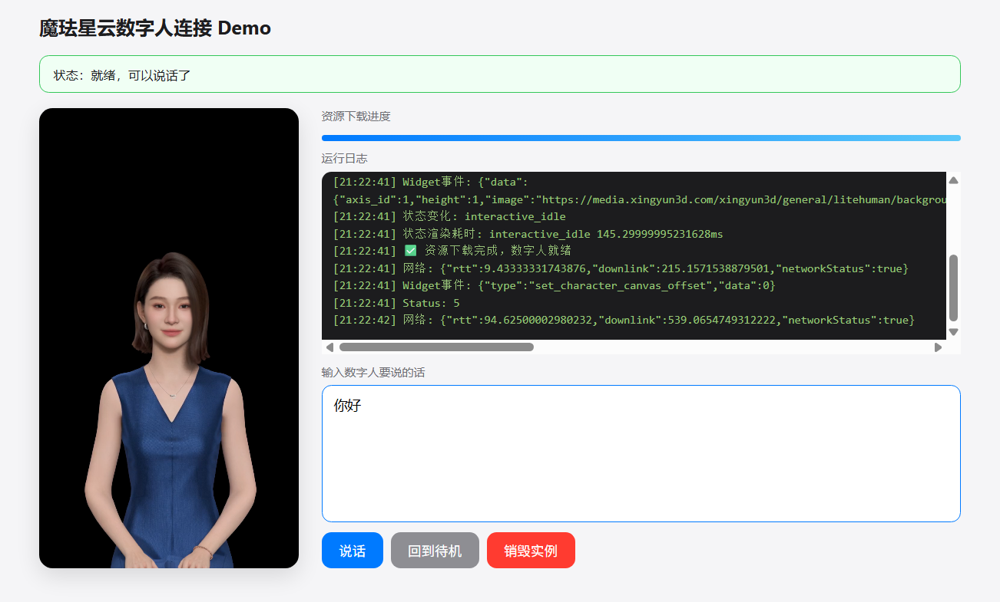
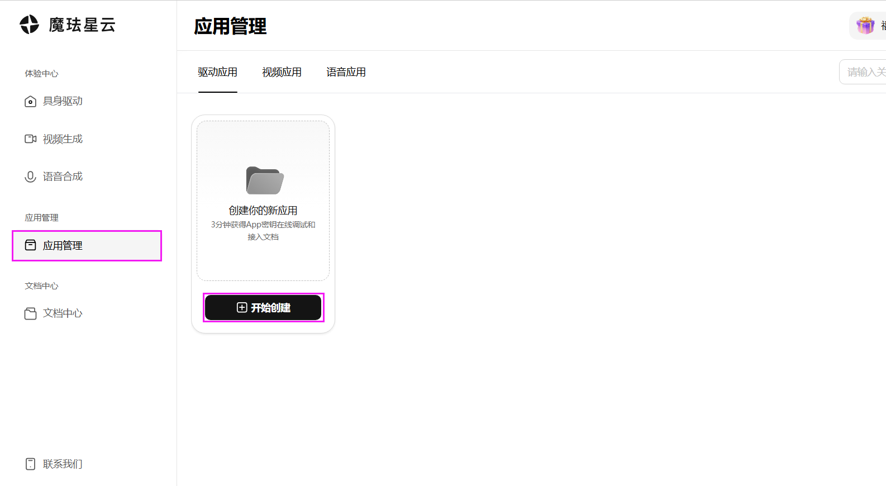
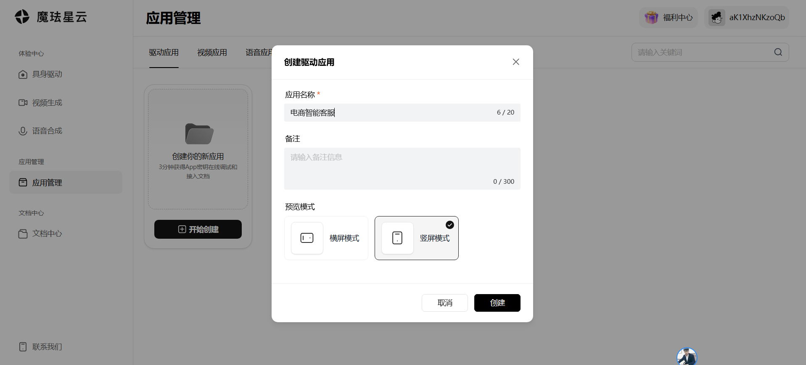
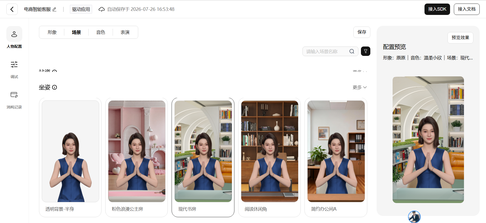
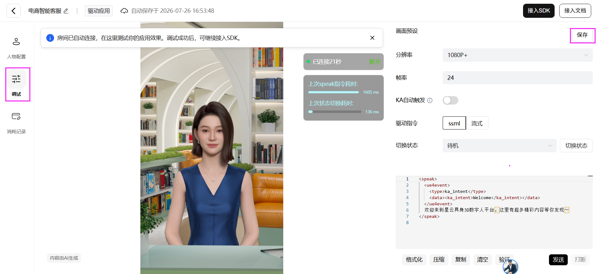
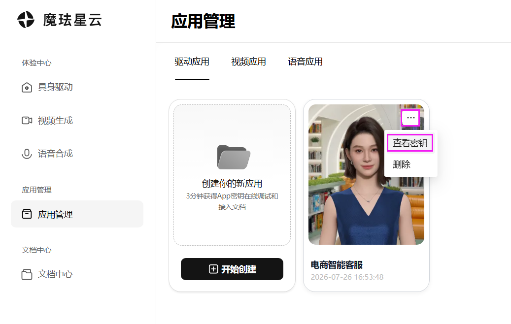
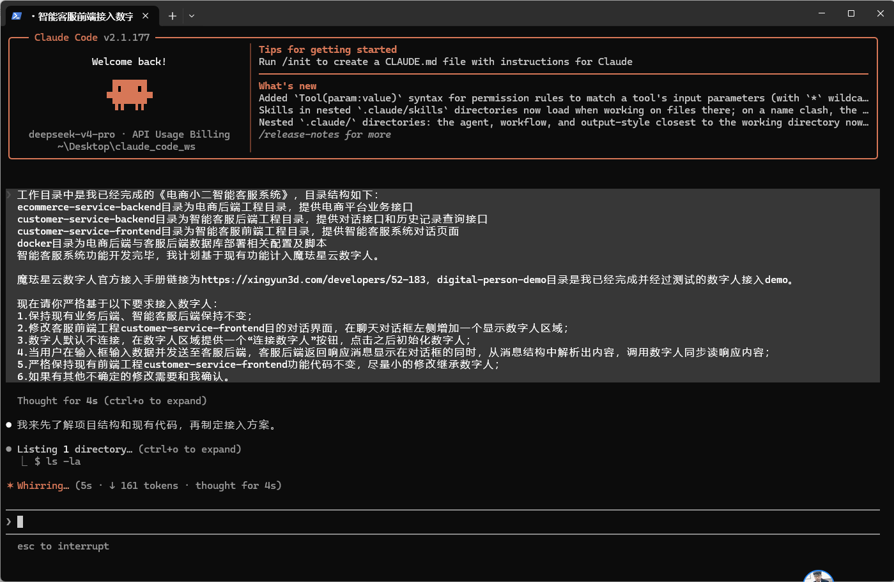
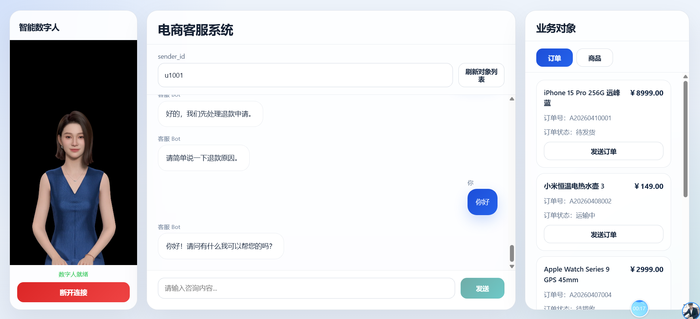

# 数字人平台

## 1. 硅基智能 DUIX 

市场份额：电商客服 32%，行业第一

优势：毫秒级实时交互、支持打断，云端 + 开源双方案，高并发稳定，3 万 + 行业话术

电商适配：直播 + 网页客服一体，自动同步商品、工单，支持主动弹窗

个人开发友好：★★★★，实名送 150 分钟免费时长，无最低消费

费用：0.25 元 / 分钟，中小商家性价比最高

短板：3D 写实质感不如魔珐

适用：淘宝 / 拼多多 / 抖店中小店铺、长期商用多门店

## 2. 阿里灵眸

市场份额：淘系独占 21%

优势：达摩院多模态，打通淘宝 / 瓴羊订单，端侧渲染省带宽

电商适配：仅支持淘系，订单物流优惠券一键互通

个人开发友好：★★，仅 30 分钟免费，绑定阿里云企业体系

费用：0.55 元 / 分钟，定价偏高

短板：跨平台、小程序、独立站适配极差

适用：仅天猫纯淘系商家

## 3. 腾讯智影

市场份额：微信私域 16%

优势：混元大模型打通微信生态，轻量 2D 数字人，简易 JS SDK

电商适配：企业微信、视频号、微信小程序无缝接入

个人开发友好：★★★★★，微信实名每月 100 分钟免费

费用：0.28 元 / 分钟，包月划算

短板：3D 形象少，复杂售后语义偏弱

适用：私域商城、视频号、微信小程序客服

## 4. 魔珐星云（mó fà）

市场份额：高端网页客服 12%

优势：影视级 3D 微表情动作，端侧低带宽渲染，透明弹窗嵌入网页

电商适配：画面质感顶尖，接口易对接自有客服系统

个人开发友好：★★★★★，实名 300 分钟免费，单 HTML 即可本地测试

费用：0.2 元 / 分钟

短板：大批量小店部署成本高

适用：品牌官网、高端美妆奢侈品客服、个人快速开发 Demo

## 5. 百度曦灵

市场份额：跨平台 / 跨境 9%

优势：文心大模型高语义准确率，2D/3D 全覆盖，多语种、高合规

电商适配：全平台通用，跨境独立站最优

个人开发友好：★★★，50 分钟免费，文档偏企业

费用：0.4 元 / 分钟，主推企业套餐

短板：前端 SDK 冗余，接入工作量大

适用：多平台统一客服、亚马逊 / Shopify 跨境站

## 6. 火山引擎数字人

市场份额：抖店垂直 7%

优势：ByteRTC 高并发音视频，短视频 + 实时客服一体化

电商适配：原生适配抖音小店，商品素材一键同步

个人开发友好：★★★★，实名 100 分钟免费，小程序 Demo 齐全

费用：0.35 元 / 分钟

短板：淘系、微信生态适配差

适用：抖音小店、抖音小程序导购

## 7. 科大讯飞虚拟人

市场份额：语音客服 3%

优势：顶级语音识别合成，多方言多语种，网页 + 电话双数字人

电商适配：电话进线、售后语音纠纷处理强

个人开发友好：★★★，50 分钟免费，形象模板少

费用：0.42 元 / 分钟

短板：3D 形象稀缺，视觉表现一般

适用：带电话进线全渠道客服、跨境外贸咨询

# Web端接入教程

## 前置知识：你的 Demo 最终长什么样

最终效果：



你会得到一个包含 3D 数字人画面的页面，在输入框里打字，点「说话」，数字人就会用流畅的表情和动作把你说的话讲出来。

---

## 准备工作：申请魔珐星云账号并创建应用

首先，这一步是跟魔珐星云平台打交道，不涉及代码，你只需要：

1. 打开浏览器访问 https://xingyun3d.com/
2. 注册/登录账号
3. 进入「应用中心」，点击「创建应用」→ 选择「具身驱动应用」
4. 在创建页面选择你喜欢的数字人形象、音色、表演风格
5. 创建成功后，你会获得两个关键凭证：

| 字段           | 说明                   | 示例                               |
| -------------- | ---------------------- | ---------------------------------- |
| **App ID**     | 应用的唯一标识         | `49a1ea0e116d4f44b50f6690ce2e7878` |
| **App Secret** | 应用的密钥（等同密码） | `32b37a58a0664d2c93b9732ae354fb2f` |

> **⚠️ 安全警告**：App Secret 等同于你的应用密码，**绝对不能**提交到公开的代码仓库（如 GitHub）。本教程里直接写在代码中仅用于学习和本地 Demo，正式项目必须放在后端。

记下你的 App ID 和 App Secret，马上要用。

| 1.点击应用管理，点击开始创建                                 |
| ------------------------------------------------------------ |
|  |

| 2.输入应用名称                                               |
| ------------------------------------------------------------ |
|  |

| 3.人物配置：形象、场景、音色、表演                           |
| ------------------------------------------------------------ |
|  |

| 4.调试、保存                                                 |
| ------------------------------------------------------------ |
|  |

| 5.查看秘钥：App ID  和 App Secret                            |
| ------------------------------------------------------------ |
|  |

## 第一步：搭建 HTML 骨架

> **本步目标**：创建一个空白的 HTML 文件，放入数字人的渲染容器。

创建一个新文件 `demo.html`，写入以下基础结构：

```html
<!DOCTYPE html>
<html lang="zh-CN">
<head>
  <meta charset="UTF-8">
  <!-- 让页面在手机上也能正常显示 -->
  <meta name="viewport" content="width=device-width, initial-scale=1.0">
  <title>魔珐星云数字人 Demo</title>
</head>
<body>
  <!-- 数字人渲染容器 -->
  <div id="sdk" style="width: 540px; height: 960px;"></div>

  <script>
    // 脚本代码放在最底部，确保 DOM 已经加载完成
  </script>
</body>
</html>
```

**关键知识点**

- `<div id="sdk">` 是数字人的渲染容器，**必须有明确的宽高**（width 和 height），否则 SDK 不知道画面该画多大
- 官方推荐 540x960 的比例（9:16 竖屏），最小不要低于 270x480
- `<script>` 放在 `</body>` 之前，避免在 DOM 还没加载完时就执行脚本导致找不到容器

---

## 第二步：引入 SDK 脚本

> **本步目标**：加载魔珐星云 SDK，获得 `XmovAvatar` 构造函数。

在 `</body>` 之前（数字人容器的后面）加载魔珐星云提供的 JS SDK：

```html
  <!-- 加载魔珐星云具身驱动 SDK -->
  <script src="https://media.xingyun3d.com/xingyun3d/general/litesdk/xmovAvatar@latest.js"></script>

  <script>
    // 你的业务代码写在这里
  </script>
</body>
```

**关键知识点**

- `@latest` 表示自动拉取最新版本的 SDK，方便随时享受最新的效果和 bug 修复
- 生产环境建议锁定版本号（如 `@0.1.0-alpha.95`），避免自动升级引发兼容性问题
- SDK 加载后会在全局注入一个 `XmovAvatar` 构造函数，这是你后续所有操作的基础

---

## 第三步：创建 SDK 实例

> **本步目标**：用 `new XmovAvatar({...})` 创建数字人实例，配置所有参数和回调。

在第二个 `<script>` 标签里写入创建实例的代码。这是整个 Demo 中**参数最多**的部分，我们逐行解释。

```html
  <script>
    // ============ 创建 SDK 实例 ============
    const LiteSDK = new XmovAvatar({
      // ------ 必填参数 ------
      containerId: '#sdk',                // 数字人画到哪个元素里（CSS 选择器）
      appId: '你的APP_ID',               // 从魔珐星云平台获取
      appSecret: '你的APP_SECRET',       // 从魔珐星云平台获取
      gatewayServer: 'https://nebula-agent.xingyun3d.com/user/v1/ttsa/session',

      // ------ 可选参数 ------
      hardwareAcceleration: 'prefer-hardware',  // 开启硬件加速，让画面更流畅
      enableLogger: true,                        // Demo 阶段开启日志，方便排查问题

      // ------ 回调函数（监听数字人的各种事件）------
      // Widget 组件事件（字幕、图片、视频等）
      onWidgetEvent(data) {
        console.log('Widget 事件:', data);
      },

      // 网络状态变化
      onNetworkInfo(networkInfo) {
        console.log('网络信息:', networkInfo);
      },

      // SDK 内部消息（错误、警告等）
      onMessage(message) {
        console.log('SDK 消息:', message);
      },

      // 数字人状态变化（idle / speaking / interactive_idle 等）
      onStateChange(state) {
        console.log('状态变化:', state);
      },

      // 连接状态变化（在线/离线/断开等）
      onStatusChange(status) {
        console.log('状态:', status);
      },

      // 从发指令到首帧渲染的耗时
      onStateRenderChange(state, duration) {
        console.log('状态渲染耗时:', state, duration + 'ms');
      },

      // 音频播放状态（说话开始 / 说话结束）
      onVoiceStateChange(status) {
        console.log('语音状态:', status);
      },

      // 会话配置不正确的警告
      onStartSessionWarning(msg) {
        console.log('配置警告:', msg);
      },
    });
  </script>
```

**关键知识点**

| 参数                   | 类型     | 必填 | 说明                                                         |
| ---------------------- | -------- | :--: | ------------------------------------------------------------ |
| `containerId`          | string   |  ✅   | 数字人渲染容器的 CSS 选择器。注意要有 `#` 或 `.`             |
| `appId`                | string   |  ✅   | 你的应用 ID                                                  |
| `appSecret`            | string   |  ✅   | 你的应用密钥                                                 |
| `gatewayServer`        | string   |  ✅   | 固定的数字人服务接口地址，文档指定，不要改                   |
| `headers`              | Object   |      | 自定义请求头，一般不需要                                     |
| `hardwareAcceleration` | string   |      | `prefer-hardware` 硬件加速 / `prefer-software` CPU 软解 / `default` 自动 |
| `enableLogger`         | boolean  |      | 是否在浏览器控制台打印 SDK 日志，开发阶段建议 `true`         |
| `onWidgetEvent`        | function |      | Widget 事件回调（字幕、图片、视频等）                        |
| `onNetworkInfo`        | function |      | 网络延迟、速率变化时触发                                     |
| `onMessage`            | function |  ✅   | SDK 错误消息，**必须设置**                                   |
| `onStateChange`        | function |      | 数字人状态变化时触发                                         |
| `onVoiceStateChange`   | function |      | 音频开始/结束播放时触发，用于管理说话状态                    |

> **⚠️ 易错点 1**：`containerId` 一定要带 `#` 号（`'#sdk'`），不能写成 `'sdk'`，否则 SDK 找不到容器。
>
> **⚠️ 易错点 2**：`appId` 和 `appSecret` 是字符串，要加引号。从平台复制后注意去掉首尾空格。
>
> **⚠️ 易错点 3**：此时数字人还**不会显示**！`new XmovAvatar` 只是创建了实例，数字人资源还没下载、房间还没连接。还需要第四步。

---

## 第四步：初始化连接 

> **本步目标**：实现“点击按钮→连接数字人→下载资源→就绪”，同一按钮在连接后变为“销毁实例”。

这是**最容易遗漏的一步**，也是为什么很多 Demo 写上代码但数字人就是不出来、消息发不出去的根本原因。

> **设计决策**：为了让你直观地控制初始化时机，**不在页面加载时自动连接**，而是创建一个按钮由你手动点击触发。同一个按钮在连接成功后自动变为「销毁实例」，点击后断开连接并恢复为「初始化连接」。

先在 HTML 里增加一个按钮（你在第五步会统一加交互控件，这里先了解按钮结构）：

```html
  <!-- 初始化连接按钮（点击后自动变为"销毁实例"） -->
  <button id="initBtn">初始化连接</button>
```

然后在 JavaScript 中，用一个**二合一函数**统一管理初始化与销毁，按钮样式随状态自动切换：

```javascript
    // ============ 初始化连接房间 ============
    let isReady = false;
    const initBtn = document.getElementById('initBtn');

    // 初始化函数（仅负责连接和监听进度）
    function initSDK() {
      LiteSDK.init({
        initModel: 'normal',
        onDownloadProgress(progress) {
          console.log('下载进度:', progress + '%');
          if (progress >= 100 && !isReady) {
            isReady = true;
            updateInitBtn();  // 按钮切换为红色「销毁实例」
            console.log('✅ 数字人就绪，可以开始对话！');
          }
        },
      });
    }

    // 按钮状态切换：蓝色"初始化连接" ⇄ 红色"销毁实例"
    function updateInitBtn() {
      if (isReady) {
        initBtn.textContent = '销毁实例';
        initBtn.className = 'btn danger';
      } else {
        initBtn.textContent = '初始化连接';
        initBtn.className = 'btn';
      }
    }

    // 二合一按钮：点击时根据 isReady 决定初始化还是销毁
    function doToggleConnection() {
      if (isReady) {
        LiteSDK.destroy();
        isReady = false;
        updateInitBtn();  // 恢复为蓝色「初始化连接」
        console.log('已销毁，可重新初始化');
      } else {
        initBtn.disabled = true;
        initBtn.textContent = '连接中…';
        initSDK();  // 发起初始化
      }
    }

    initBtn.onclick = doToggleConnection;
```

**关键知识点**

- **`init()` 是必须调用的方法**，它做三件事：
  1. 向魔珐星云服务器发起会话请求
  2. 下载数字人的 3D 模型、表情数据、场景资源
  3. 建立 WebSocket 连接，开始接收实时驱动数据流

- **`onDownloadProgress` 是必填参数**，它告诉你资源下载了多少。只有进度到 100% 之后，调 `speak()` 才有效

- **`initModel: 'invisible'`** 是隐身模式，数字人不会渲染到屏幕上，但仍然会建立连接和下载资源。适合暂时不想消耗积分的场景

- **按钮二合一设计**：用一个 `doToggleConnection` 函数同时管理初始化和销毁，文字和颜色随状态自动切换：`isReady=false` 时为蓝色「初始化连接」，`isReady=true` 时为红色「销毁实例」。用户一看就知道当前是什么状态，避免同时出现两个功能重复的按钮。

> **⚠️ 易错点**：方法名可能是 `init` 也可能是 `startSession`（取决于 SDK 版本）。如果在浏览器控制台看到 `LiteSDK.init is not a function`，就换成 `LiteSDK.startSession(...)`。最稳妥的办法是先在控制台执行 `console.log(Object.keys(LiteSDK))` 看一眼实例上有哪些方法。

---

## 第五步：让数字人开口说话 + 搭建交互界面

> **本步目标**：实现输入文字→点按钮→数字人说话的完整链路，同时搭建上下二分布局（日志在上、输入在下，总高度 480px 与数字人对齐）。

初始化完成、资源下载到 100% 之后，就可以让数字人说话了。先搭建 UI 结构——采用上下二分布局（日志在上、输入在下），高度固定对齐：

```html
  <div id="sdk" style="width: 540px; height: 960px;"></div>

  <!-- 新增：上下二分布局 —— 输入区在上，日志区在下，总高度与数字人 480px 对齐 -->
  <div style="height: 480px; display: flex; flex-direction: column; margin-top: 16px;">

    <!-- 上半部分：日志面板（flex:1 撑满） -->
    <div style="flex: 1; display: flex; flex-direction: column; margin-bottom: 10px;">
      <div style="font-size: 12px; color: #6e6e73; margin-bottom: 6px;">运行日志</div>
      <div id="log" style="flex: 1; padding: 12px; background: #1c1c1e; color: #98c379;
                  border-radius: 10px; overflow: auto; font-family: monospace; font-size: 12px;"></div>
    </div>

    <!-- 下半部分：输入框 + 按钮（flex:1 撑满） -->
    <div style="flex: 1; display: flex; flex-direction: column;">
      <div style="font-size: 12px; color: #6e6e73; margin-bottom: 6px;">输入数字人要说的话</div>
      <textarea id="content" placeholder="输入让数字人说的话..."
                style="flex: 1; padding: 8px; font-size: 14px; resize: none; border-radius: 10px;"></textarea>
      <div style="margin-top: 10px;">
        <button id="speakBtn" disabled>让数字人说话</button>
      </div>
    </div>
  </div>
```

然后在 JavaScript 里写说话逻辑：

```javascript
    // ============ 让数字人说话 ============
    const speakBtn = document.getElementById('speakBtn');

    function doSpeak() {
      const text = document.getElementById('content').value.trim();
      if (!text) {
        console.log('⚠️ 请输入内容');
        return;
      }
      if (!isReady) {
        console.log('⚠️ 数字人还没准备好，请等待初始化完成');
        return;
      }

      // 非流式一次性说话
      // 参数依次是：(SSML文本, is_start, is_end)
      // is_start=true, is_end=true 表示"一段完整的话"
      LiteSDK.speak(text, true, true);

      console.log('speak:', text);
    }

    speakBtn.onclick = doSpeak;
```

在 `onDownloadProgress` 里，当进度到 100% 时把按钮激活：

```javascript
        if (progress >= 100 && !isReady) {
            isReady = true;
            speakBtn.disabled = false;   // 激活说话按钮
            updateInitBtn();             // 同时切换为"销毁实例"按钮
            console.log('✅ 数字人就绪！');
        }
```

**关键知识点**

**`speak(ssml, is_start, is_end)` 三个参数的含义**：

| 参数       | 类型    | 说明                                                         |
| ---------- | ------- | ------------------------------------------------------------ |
| `ssml`     | string  | 要说的内容。支持纯文本（如 `"你好"`）和 SSML 格式（进阶功能） |
| `is_start` | boolean | 是否是一句话的开头                                           |
| `is_end`   | boolean | 是否是一句话的结尾                                           |

**三种常见调用方式**：

```javascript
// 方式一：非流式一次性说话（Demo 最常用）
LiteSDK.speak("欢迎来到魔珐星云", true, true);

// 方式二：流式说话（对接大模型场景）
// 第一句
LiteSDK.speak("你好，", true, false);    // 开始，但没说完
// 中间的句子
LiteSDK.speak("我是魔珐星云", false, false);
LiteSDK.speak("数字人助手", false, false);
// 最后一句
LiteSDK.speak("很高兴认识你", false, true);  // 说完了

// 方式三：纯动作，不发音
LiteSDK.speak("", true, true);
```

> **⚠️ 易错点 1**：`is_end = false` 表示话还没说完，SDK 会一直等待后续内容。如果忘记把最后一句的 `is_end` 设为 `true`，数字人会卡住不输出。
>
> **⚠️ 易错点 2**：**不要**写成 Python 风格的 `speak(text, is_start=true, is_end=true)` —— 这是 Python 的关键字参数语法，JavaScript 不支持！在 JS 严格模式下会直接报错。
>
> **⚠️ 易错点 3**：如果前一次 `speak` 以 `is_end=true` 结束，紧接着又调 `speak`，官方建议中间用 `interactiveidle()` 切换一次状态，否则口型对不上。

---

## 第六步：加入状态控制

> **本步目标**：补充待机打断、离线省积分两个核心状态切换能力，完善交互闭环。

一个完整的 Demo 还需要能控制数字人的状态。此时我们已经有了三个按钮：「说话」「回到待机」「初始化连接」（第四步实现，连接后自动变为「销毁实例」）。再补充一些状态控制函数：

```html
  <button id="speakBtn" disabled>让数字人说话</button>
  <button onclick="doIdle()">回到待机</button>
  <button id="initBtn">初始化连接</button>
```

> 上面第三个按钮就是第四步的二合一按钮——没连时显示「初始化连接」，连接后自动变为「销毁实例」。

```javascript
    // ============ 状态控制 ============

    // 回到待机（打断当前说话/动作）
    function doIdle() {
      LiteSDK.interactiveidle();
      console.log('切换回待机状态');
    }

    // 进入离线模式（不消耗积分，数字人消失）
    function goOffline() {
      LiteSDK.offlineMode();
      console.log('进入离线模式');
    }

    // 回到在线模式
    function goOnline() {
      LiteSDK.onlineMode();
      console.log('回到在线模式');
    }

    // 销毁实例已由第四步的 doToggleConnection() 统一管理
    // 无需单独的 doDestroy 按钮
```

**数字人状态一览**

| 状态     | 英文名           | 方法                            | 说明                     |
| -------- | ---------------- | ------------------------------- | ------------------------ |
| 在线     | online           | `onlineMode()`                  | 正常连接，可以交互       |
| 离线     | offline          | `offlineMode()`                 | 断开连接，不消耗积分     |
| 待机     | idle             | `idle()`                        | 等待用户交互的停顿动画   |
| 互动待机 | interactive_idle | `interactiveidle()`             | 可打断当前状态的循环动画 |
| 说话中   | speak            | `speak(text, is_start, is_end)` | 数字人说话驱动           |

---

## 第七步：页面卸载前清理资源

> **本步目标**：关闭/刷新页面时自动断开连接，避免触发并发限制（错误码 10005）。

这是一个**良好的编程习惯**——用户关闭页面或刷新时，主动断开连接释放服务端资源，避免触发并发限制（错误码 10005）。

```javascript
// ============ 页面卸载清理 ============
window.addEventListener('beforeunload', function() {
    try {
        LiteSDK.destroy();
    } catch (e) {
        // 忽略销毁时的异常（比如实例已经不存在了）
    }
});
```

---

## 进阶：SSML、KA 动作与 Widget 组件

### SSML：让数字人边说边做动作

SSML（语音合成标记语言）可以在说话的同时触发数字人的动作。比如：

```javascript
// 说"欢迎"时，数字人配合做"Welcome"动作
LiteSDK.speak(
  `<speak>
    热烈
    <ue4event>
      <type>ka_intent</type>
      <data><ka_intent>Welcome</ka_intent></data>
    </ue4event>
    欢迎各位贵宾莅临指导！
  </speak>`,
  true, true
);
```

更多 KA 动作参考官方的 KA 查询接口文档：https://xingyun3d.com/developers/52-192

### Widget：数字人画面上的叠加组件

SDK 支持在数字人画面上叠加字幕、图片、视频等组件。通过 `onWidgetEvent` 或 `proxyWidget` 来自定义这些行为：

```javascript
// 方式一：统一代理所有 Widget 事件
onWidgetEvent(data) {
  // data.type 可能是 'subtitle_on'、'widget_pic' 等
  if (data.type === 'subtitle_on') {
    // 处理字幕显示
  }
},

// 方式二：按事件类型分别代理（优先级低于 onWidgetEvent）
proxyWidget: {
  'subtitle_on': (data) => { /* 自定义字幕 */ },
  'widget_video': (data) => { /* 自定义视频播放 */ },
},
```

**事件优先级**：`onWidgetEvent` > `proxyWidget` > SDK 默认行为

---

## 常见错误码与排查指南

|  错误码   | 含义            | 可能原因                    | 解决方法                                          |
| :-------: | --------------- | --------------------------- | ------------------------------------------------- |
| **10001** | 容器不存在      | `containerId` 写错了        | 检查选择器是否带 `#`，确认 DOM 中是否存在该元素   |
| **10002** | Socket 连接错误 | 网络不通或地址不对          | 检查 `gatewayServer` 地址是否正确，确认能访问外网 |
| **10003** | 创建会话失败    | `appId` 或 `appSecret` 错误 | 去魔珐星云平台核对应用凭证                        |
| **10004** | 关闭会话失败    | 网络异常                    | 一般不影响使用，重试即可                          |
| **10005** | 超出并发限制    | 多个页面同时连接同一应用    | 调用 `destroy()` 释放连接后再重试                 |
| **50001** | 进入离线模式    | 正常状态切换                | 不是错误，无需处理                                |
| **50002** | 回到在线模式    | 正常状态切换                | 不是错误，无需处理                                |

**调试技巧**：在开发阶段把 `enableLogger` 设为 `true`，浏览器控制台会打印详细的 SDK 日志，绝大多数问题可以从日志中直接定位。

**一定要用 localhost 启动**：SDK 不支持通过 `file://` 协议或 IP + HTTP 访问，必须使用 `localhost` 或 HTTPS 域名。最简单的方式是用 VS Code 的 Live Server 插件，或运行：

```bash
# Python 3
python -m http.server 8080

# Node.js（需要安装 http-server）
npx http-server -p 8080
```

然后在浏览器打开 `http://localhost:8080/demo.html`。

## 附录：完整代码

把以下代码复制到一个 `.html` 文件，用 `localhost` 启动即可运行。

> 请将 `APP_ID` 和 `APP_SECRET` 替换为你在魔珐星云平台获取的真实凭证。

```html
<!DOCTYPE html>
<html lang="zh-CN">
<head>
  <meta charset="UTF-8">
  <meta name="viewport" content="width=device-width, initial-scale=1.0">
  <title>魔珐星云数字人连接 Demo（修复版）</title>
  <style>
    * { box-sizing: border-box; }
    body {
      font-family: -apple-system, "Segoe UI", "Microsoft YaHei", sans-serif;
      margin: 0; padding: 24px; background: #f5f5f7; color: #1d1d1f;
    }
    .wrap { max-width: 960px; margin: 0 auto; }
    h2 { font-size: 20px; margin: 0 0 16px; }
    .status {
      padding: 10px 14px; border-radius: 10px; background: #fff;
      border: 1px solid #e0e0e0; margin-bottom: 16px; font-size: 13px;
      transition: all .25s;
    }
    .status.loading { border-color: #ff9500; background: #fff8f0; }
    .status.ready   { border-color: #34c759; background: #f0fff4; }
    .status.error   { border-color: #ff3b30; background: #fff0f0; }
    .panel { display: flex; gap: 24px; align-items: flex-start; flex-wrap: wrap; }
    .avatar-box {
      width: 270px; height: 480px; border-radius: 14px; overflow: hidden;
      background: #000; box-shadow: 0 8px 24px rgba(0,0,0,.12);
    }
    #sdk { width: 270px; height: 480px; }
    .controls {
      flex: 1; min-width: 300px; height: 480px; /* 与左侧数字人等高 */
      display: flex; flex-direction: column;
    }
    .label { font-size: 12px; color: #6e6e73; margin-bottom: 6px; }
    .btn-row { display: flex; gap: 8px; flex-wrap: wrap; }
    .btn {
      padding: 9px 18px; border: none; border-radius: 10px; background: #007aff;
      color: #fff; font-size: 14px; cursor: pointer; transition: transform .15s, opacity .15s;
    }
    .btn:hover:not(:disabled) { transform: translateY(-1px); }
    .btn:disabled { background: #c7c7cc; cursor: not-allowed; }
    .btn.ghost { background: #8e8e93; }
    .btn.danger { background: #ff3b30; }
    .progress { flex-shrink: 0; height: 6px; background: #e0e0e0; border-radius: 3px; margin: 6px 0 10px; overflow: hidden; }
    .progress-bar { height: 100%; background: linear-gradient(90deg,#007aff,#5ac8fa); width: 0%; transition: width .3s; }

    /* 日志区域（上半部分，flex:1 撑满） */
    .log-section {
      flex: 1; min-height: 0; display: flex; flex-direction: column; margin-bottom: 10px;
    }
    .input-section textarea {
      flex: 1; min-height: 0; width: 100%; padding: 10px 12px; border-radius: 10px;
      border: 1px solid #d2d2d7; font-size: 14px; resize: none; font-family: inherit;
    }
    .input-section textarea:focus { outline: none; border-color: #007aff; }
    .input-section .btn-row { margin-top: 10px; }

    /* 输入区域（下半部分，flex:1 撑满） */
    .input-section {
      flex: 1; min-height: 0; display: flex; flex-direction: column;
    }
    .log {
      flex: 1; min-height: 0; padding: 12px; background: #1c1c1e; color: #98c379;
      border-radius: 10px; font-family: Consolas, "SF Mono", monospace; font-size: 12px;
      overflow: auto; white-space: pre-wrap; line-height: 1.5;
    }
  </style>
</head>
<body>
  <div class="wrap">
    <h2>魔珐星云数字人连接 Demo</h2>
    <div id="status" class="status">状态：等待初始化…</div>

    <div class="panel">
      <div class="avatar-box"><div id="sdk"></div></div>

      <div class="controls">
        <div class="label">资源下载进度</div>
        <div class="progress"><div id="progressBar" class="progress-bar"></div></div>

        <!-- 上半部分：日志输出 -->
        <div class="log-section">
          <div class="label">运行日志</div>
          <div id="log" class="log"></div>
        </div>

        <!-- 下半部分：输入框 + 按钮 -->
        <div class="input-section">
          <div class="label">输入数字人要说的话</div>
          <textarea id="content" placeholder="例如：欢迎使用电商小二智能客服平台"></textarea>
          <div class="btn-row">
            <button id="speakBtn" class="btn" onclick="doSpeak()" disabled>说话</button>
            <button class="btn ghost" onclick="doIdle()">回到待机</button>
            <button id="initBtn" class="btn" onclick="doToggleConnection()">初始化连接</button>
          </div>
        </div>
      </div>
    </div>
  </div>

  <script src="https://media.xingyun3d.com/xingyun3d/general/litesdk/xmovAvatar@latest.js"></script>
  <script>
    /* ============================================================
     * 日志 & 状态辅助
     * ============================================================ */
    const logEl = document.getElementById('log');
    function log() {
      const parts = Array.from(arguments).map(a =>
        (a && typeof a === 'object') ? JSON.stringify(a) : a
      );
      const line = '[' + new Date().toLocaleTimeString() + '] ' + parts.join(' ');
      logEl.textContent += line + '\n';
      logEl.scrollTop = logEl.scrollHeight;
      console.log.apply(console, arguments);
    }

    const statusEl   = document.getElementById('status');
    const progressBar= document.getElementById('progressBar');
    const speakBtn   = document.getElementById('speakBtn');
    const initBtn    = document.getElementById('initBtn');
    function setStatus(text, level) {
      statusEl.textContent = '状态：' + text;
      statusEl.className = 'status ' + (level || '');
    }

    /* ============================================================
     * 1. 创建 SDK 实例
     * ============================================================ */
    const LiteSDK = new XmovAvatar({
      containerId: '#sdk',
      appId: 'your_appId',     // TODO: 替换为你的 appId（建议从后端获取）
      appSecret: 'your_appSecret',  // TODO: 替换为你的 appSecret（切勿提交到代码仓库）
      gatewayServer: 'https://nebula-agent.xingyun3d.com/user/v1/ttsa/session',
      headers: {},
      hardwareAcceleration: 'prefer-hardware',
      enableLogger: true,

      onWidgetEvent(data) { 
		  log('Widget事件:', data); 
	 },
      proxyWidget: {
        widget_slideshow: (data) => log('widget_slideshow', data),
        widget_video:     (data) => log('widget_video', data),
      },
      onNetworkInfo(networkInfo) { log('网络:', networkInfo); },
      onMessage(message) {
        log('SDK消息:', message);
        // 仅对真正的错误码亮红，50001/50002 是在线/离线模式切换，属正常
        if (message && message.code && message.code !== 50001 && message.code !== 50002) {
          setStatus('SDK错误 code=' + message.code + ' ' + (message.message || ''), 'error');
        }
      },
      onStateChange(state) { log('状态变化:', state); },
      onStatusChange(status) { log('Status:', status); },
      onStateRenderChange(state, duration) { log('状态渲染耗时:', state, duration + 'ms'); },
      onVoiceStateChange(status) {
        log('语音:', status);
        if (status === 'start')      setStatus('数字人正在说话…', 'loading');
        else if (status === 'end')   setStatus('就绪', 'ready');
      },
      onStartSessionWarning(msg) { log('会话配置警告:', msg); },
    });

    /* ============================================================
     * 2. 初始化连接房间（关键步骤——原 demo 完全缺失）
     *    必须等资源下载完成（progress >= 100）后才能 speak
     * ============================================================ */
    let inited = false;
    function initSDK() {
      setStatus('正在初始化，下载资源中…', 'loading');
      LiteSDK.init({
        initModel: 'normal',
        onDownloadProgress(progress) {
          progressBar.style.width = progress + '%';
          if (progress >= 100 && !inited) {
            inited = true;
            setStatus('就绪，可以说话了', 'ready');
            speakBtn.disabled = false;
            updateInitBtn();
            log('✅ 资源下载完成，数字人就绪');
          }
        },
      });
    }

    /* ============================================================
     * 3. 驱动数字人说话
     *    非流式一次性说话：is_start=true, is_end=true
     *    原 demo 错误：is_end=false 会导致一句话永远说不完
     * ============================================================ */
    function doSpeak() {
      const text = document.getElementById('content').value.trim();
      if (!text)  { log('⚠️ 请输入内容'); return; }
      if (!inited){ log('⚠️ 数字人尚未初始化完成，请等待进度到 100%'); return; }
	  //                  is_start,is_end
      LiteSDK.speak(text, true, true);   // 正确的 JS 传参，不要写成 is_start=true
      log('speak:', text);
    }

    /* ============================================================
     * 4. 回到待机（speak 之间建议用 interactiveidle 切换状态）
     * ============================================================ */
    function doIdle() {
      LiteSDK.interactiveidle();
      log('切回待机');
    }

    /* ============================================================
     * 5. 销毁实例，释放连接（避免超出房间并发限制 10005）
     * ============================================================ */
    function doDestroy() {
      LiteSDK.destroy();
      inited = false;
      speakBtn.disabled = true;
      progressBar.style.width = '0%';
      updateInitBtn();
      setStatus('已销毁，可重新初始化连接', 'error');
      log('实例已销毁');
    }

    /* ============================================================
     * 5. 初始化/销毁按钮二合一状态切换
     *    未连接 → 显示"初始化连接"（蓝色）
     *    连接中 → 按钮禁用，显示"连接中…"
     *    已连接 → 显示"销毁实例"（红色）
     * ============================================================ */
    function updateInitBtn() {
      if (inited) {
        initBtn.textContent = '销毁实例';
        initBtn.className = 'btn danger';
        initBtn.disabled = false;
      } else {
        initBtn.textContent = '初始化连接';
        initBtn.className = 'btn';
        initBtn.disabled = false;
      }
    }

    function doToggleConnection() {
      if (inited) {
        doDestroy();
      } else {
        initBtn.disabled = true;
        initBtn.textContent = '连接中…';
        initSDK();
      }
    }

    /* ============================================================
     * 6. 页面卸载前清理资源（官方最佳实践）
     * ============================================================ */
    window.addEventListener('beforeunload', () => {
      try { LiteSDK.destroy(); } catch (e) { /* 忽略 */ }
    });

    /* ============================================================
     * 页面初始化状态：等待用户点击"初始化连接"按钮
     * 设置初始状态
     * ============================================================ */
    setStatus('等待初始化，请点击「初始化连接」按钮');
  </script>
</body>
</html>
```


# 电商小二数字人接入指南

> 基于电商小二智能客服系统接入魔珐星云数字人——纯前端接入

## 前端接入实现

1. 构建Claude工程目录

   

2. 提示词：

```
工作目录中是我已经完成的《电商小二智能客服系统》，目录结构如下：
ecommerce-service-backend目录为电商后端工程目录，提供电商平台业务接口
customer-service-backend目录为智能客服后端工程目录，提供对话接口和历史记录查询接口
customer-service-frontend目录为智能客服前端工程目录，提供智能客服系统对话页面
docker目录为电商后端与客服后端数据库部署相关配置及脚本
智能客服系统功能开发完毕，我计划基于现有功能计入魔珐星云数字人。

魔珐星云数字人官方接入手册链接为https://xingyun3d.com/developers/52-183，digital-person-demo目录是我已经完成并经过测试的数字人接入demo。

现在请你严格基于以下要求接入数字人：
1.严格保持现有业务后端、智能客服后端不变；
2.修改客服前端工程customer-service-frontend目录的对话界面，<在聊天对话框左侧增加一个显示数字人区域>；
3.数字人默认不连接，在数字人区域提供一个“连接数字人”按钮，点击之后初始化数字人<此处可以增加数字人加载效果的描述>；
4.当用户在输入框输入数据并发送至客服后端，客服后端返回响应消息显示在对话框的同时，从消息结构中解析出内容，调用数字人同步读响应内容；
5.严格保持现有前端工程customer-service-frontend功能代码不变，尽量小的修改集成数字人；
6.如果有其他不确定的修改需要和我确认。
```





## 安全性问题分析

**App Secret 绝对不能写在前端**：本教程为了方便 Demo 测试写在了代码里，但一旦页面部署到公网，任何人 F12 就能看到你的密钥。生产环境必须在后端做一层代理接口，由后端用 App Secret 换取一次性 Token 再下发给前端。

| 事项                   | 操作                                              |
| ---------------------- | ------------------------------------------------- |
| 从源码中移除硬编码密钥 | 删除 App.vue 和 test_page.html 中的明文密钥       |
| 密钥存入后端 .env      | 和现有 LLM_API_KEY 一样管理                       |
| 后端新增凭证接口       | GET /api/digital-human/credentials                |
| 前端动态获取凭证       | initDigitalHuman () 改为 async，先 fetch 再初始化 |
| .env 加入 .gitignore   | 检查确认 .env 不会被提交到仓库                    |

## 凭证安全改造指南

> **目标**：将数字人（魔珐星云）的 AppId / AppSecret 从源码中移除，改为通过后端 API 动态获取，消除密钥泄露风险。

---

### 改造概览

```
改造前（硬编码）：
  前端源码 ──→ 包含明文 appId / appSecret  ❌ 代码仓库泄露风险

改造后（后端代理）：
  前端 ──GET /api/digital-human/credentials──→ 后端 ──读取 .env──→ 返回凭证
         ←──── { app_id, app_secret, gateway_server } ────
  前端拿到凭证后初始化 SDK
```

**核心原则：密钥只存在于后端 `.env` 文件中，永远不会出现在前端源码中。**

---

### 改造步骤

#### 一、后端改造（3 个文件）

##### 1.1 在 `.env` 中添加数字人凭证

**文件**：`customer-service-backend/.env`

在文件末尾追加以下内容：

```env
# 数字人（魔珐星云）
DIGITAL_HUMAN_APP_ID=你的AppId
DIGITAL_HUMAN_APP_SECRET=你的AppSecret
DIGITAL_HUMAN_GATEWAY_SERVER=https://nebula-agent.xingyun3d.com/user/v1/ttsa/session
```

> **注意**：将 `你的AppId` 和 `你的AppSecret` 替换为魔珐星云后台提供的实际值。`GATEWAY_SERVER` 如无特殊需求保持默认即可。

##### 1.2 在 `config.py` 中新增配置字段

**文件**：`customer-service-backend/atguigu/config/config.py`

在 `Settings` 类中，`app_port` 之后、`settings = Settings()` 之前，添加以下字段：

```python
    # 数字人（魔珐星云）
    digital_human_app_id: str
    digital_human_app_secret: str
    digital_human_gateway_server: str = "https://nebula-agent.xingyun3d.com/user/v1/ttsa/session"
```

修改后的 `Settings` 类大致如下：

```python
class Settings(BaseSettings):
    model_config = SettingsConfigDict(env_file=ENV_FILE, env_file_encoding="utf-8", extra="ignore")

    # LLM
    llm_api_key: str
    llm_model: str
    llm_base_url: str

    # 数据库
    database_url: str

    # 电商后端API的BASE_URL
    commerce_api_base_url: str

    # 服务器
    app_host: str
    app_port: int

    # 数字人（魔珐星云）      ← 新增
    digital_human_app_id: str
    digital_human_app_secret: str
    digital_human_gateway_server: str = "https://nebula-agent.xingyun3d.com/user/v1/ttsa/session"
```

> **说明**：`pydantic-settings` 会自动将 `.env` 中的 `DIGITAL_HUMAN_APP_ID` 映射为 `digital_human_app_id` 属性。`gateway_server` 设置了默认值，如不需要修改可以不配置。

##### 1.3 在 `routers.py` 中新增凭证接口

**文件**：`customer-service-backend/atguigu/api/routers.py`

**步骤 A**：在文件顶部的 import 区域，添加 `settings` 的导入：

```python
from atguigu.config.config import settings
```

**步骤 B**：在文件末尾（`chat_history` 接口之后），新增以下接口：

```python
@router.get("/api/digital-human/credentials")
async def get_digital_human_credentials():
    """前端获取数字人（魔珐星云）SDK 初始化凭证。
    密钥仅存储在后端 .env，不暴露在前端源码中。
    """
    return {
        "app_id": settings.digital_human_app_id,
        "app_secret": settings.digital_human_app_secret,
        "gateway_server": settings.digital_human_gateway_server,
    }
```

---

#### 二、前端改造（2 个文件）

##### 2.1 修改 `App.vue` 中的 `initDigitalHuman` 函数

**文件**：`customer-service-frontend/src/App.vue`

**改动说明**：将 `initDigitalHuman` 从普通函数改为 `async` 函数，在初始化 SDK 之前先调用后端接口获取凭证。

**修改前**（约第 240 行）：

```js
function initDigitalHuman() {
  digitalHumanConnecting.value = true
  digitalHumanProgress.value = 0

  liteSDK = new XmovAvatar({
    containerId: '#digital-human-sdk',
    appId: '49a1ea0e116d4f44b50f6690ce2e7878',       // ← 硬编码的凭证
    appSecret: '32b37a58a0664d2c93b9732ae354fb2f',    // ← 硬编码的凭证
    gatewayServer: 'https://nebula-agent.xingyun3d.com/user/v1/ttsa/session',
    // ... 其余配置
  })
  // ...
}
```

**修改后**：

```js
async function initDigitalHuman() {
  digitalHumanConnecting.value = true
  digitalHumanProgress.value = 0

  // 从后端获取数字人凭证（密钥仅存储在后端 .env，不暴露在前端源码中）
  let cred
  try {
    const resp = await fetch('/api/digital-human/credentials')
    if (!resp.ok) throw new Error('获取凭证失败')
    cred = await resp.json()
  } catch (e) {
    digitalHumanConnecting.value = false
    errorMessage.value = '获取数字人凭证失败，请检查后端服务'
    console.error('[数字人] 获取凭证失败:', e)
    return
  }

  liteSDK = new XmovAvatar({
    containerId: '#digital-human-sdk',
    appId: cred.app_id,
    appSecret: cred.app_secret,
    gatewayServer: cred.gateway_server,
    // ... 其余配置保持不变
  })
  // ...
}
```

> **关键点**：
>
> - `/api/digital-human/credentials` 已被 Vite 代理配置（`vite.config.js`）转发到后端 `http://127.0.0.1:18082`
> - 如果 `fetch` 失败（后端未启动或接口异常），会显示错误提示并中止初始化

##### 2.2 更新 Demo 页面说明

**文件**：`digital-person-demo/test_page.html`

该文件是独立 Demo 页面，不依赖后端服务。已将注释更新为更明确的警告标识，提示开发者替换为自己的凭证，避免将密钥提交到代码仓库。

---

#### 三、验证检查

完成以上步骤后，请按以下项目逐项确认：

| #    | 检查项                     | 预期结果                                                     |
| ---- | -------------------------- | ------------------------------------------------------------ |
| 1    | `.env` 已加入 `.gitignore` | `git status` 不显示 `.env` 变更                              |
| 2    | 后端启动正常               | `python main.py` 无报错                                      |
| 3    | 凭证接口可访问             | 浏览器访问 `http://127.0.0.1:18082/api/digital-human/credentials` 返回 JSON |
| 4    | 前端源码不含硬编码密钥     | 在 `App.vue` 中搜索 `appId:` / `appSecret:` 不出现明文密钥字符串 |
| 5    | 前端初始化正常             | 打开页面 → 点击「连接数字人」→ 数字人正常加载出现            |
| 6    | 数字人正常朗读             | 发送消息后，数字人正常朗读 Bot 的回复内容                    |
| 7    | Git 历史无密钥提交         | 如果之前已提交过密钥到 Git，建议在魔珐星云后台轮换密钥       |

---

### 可选增强

以下增强项可根据安全需求选择性实施：

#### 方案 A：接口添加用户鉴权

在 `/api/digital-human/credentials` 接口上添加登录态校验，防止未授权用户获取凭证：

```python
@router.get("/api/digital-human/credentials")
async def get_digital_human_credentials(
    current_user = Depends(get_current_user)  # 假设已有认证中间件
):
    ...
```

#### 方案 B：后端代理全量请求

将数字人 SDK 与魔珐星云网关的所有通信都经过后端转发，前端完全不接触任何凭证。实现复杂、延迟增加，一般不需要。

#### 方案 C：一次性 Token 模式

后端调用魔珐星云 API 换取短期有效的临时 Token，前端拿到 Token 后初始化 SDK。Token 过期后需重新获取。这需要魔珐星云支持临时凭证机制。
