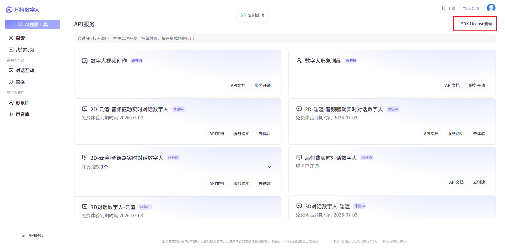
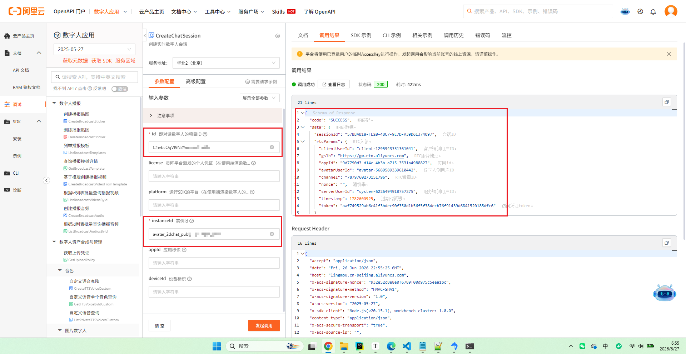
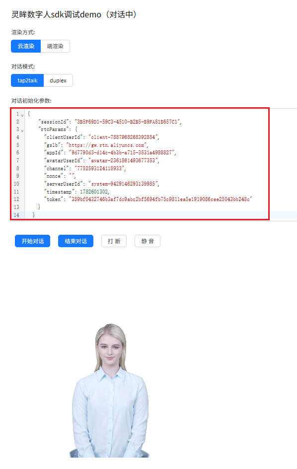
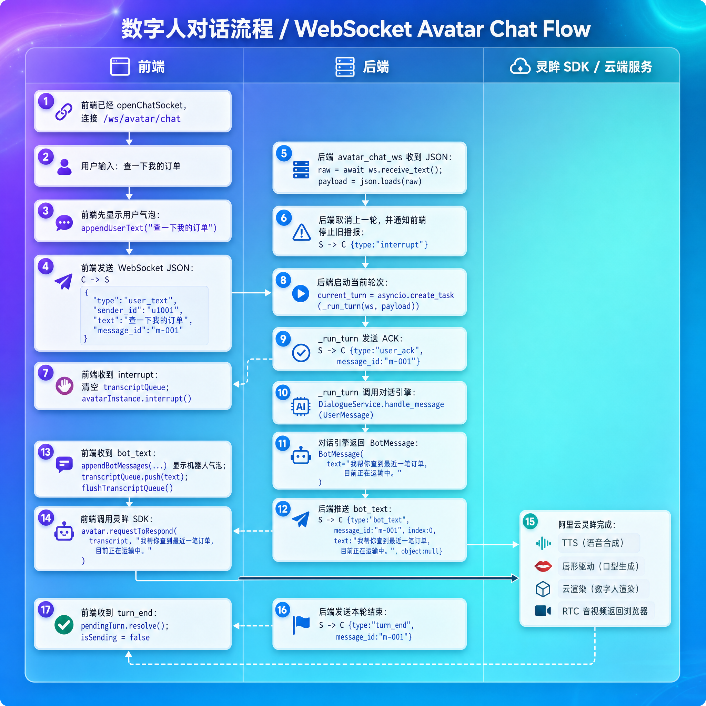
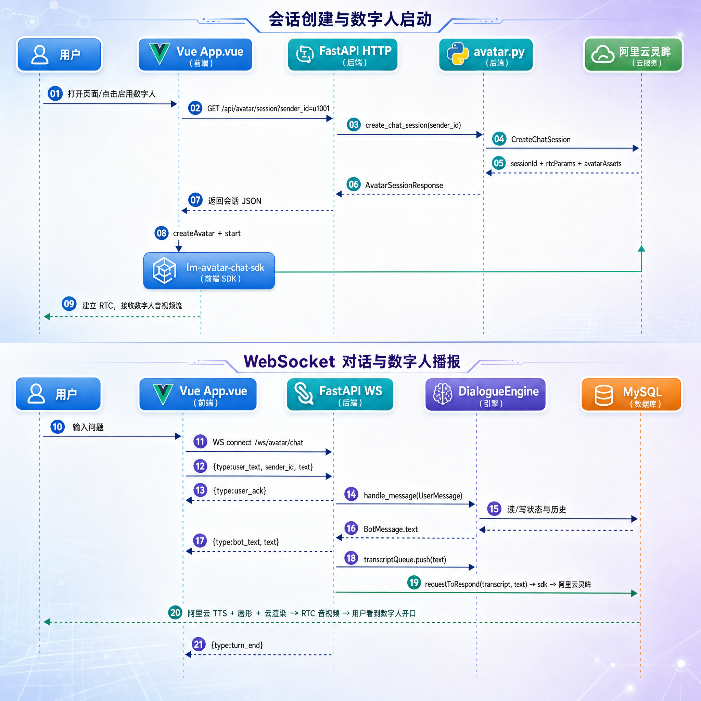

# 阿里灵眸数字人集成 

## 一、数字人功能说明

这一节要做的是把文字客服升级成“看得见、听得到”的数字人客服。用户还是在前端输入文字，后端仍然复用同一套 `DialogueService` 和 `DialogueEngine`，区别只是：机器人回复出来以后，不只显示在聊天气泡里，还要交给阿里云灵眸数字人，由数字人把这段话说出来。

> 用户输入 → 后端对话引擎生成回复 → WebSocket 推送回复文本 → 前端调用灵眸 SDK → 阿里云完成 TTS、唇形和云渲染 → 数字人开口说话。

这里要特别注意一个边界：**当前项目使用 transcript 模式**。也就是说，后端只生成和推送回复文本，不做 TTS，也不推 PCM 音频。声音、唇形、画面渲染都交给阿里云灵眸服务端完成。

**PCM** 的全称是 **Pulse-Code Modulation（脉冲编码调制）**。简单来说，它是**将自然界中连续的模拟音频信号（比如人说话的声音）转换成计算机能够理解和处理的离散数字信号**的标准方法。在开发语音合成（TTS）、自动语音识别（ASR）或实时对话的底层系统时，PCM 几乎是一定会接触到的最核心、最基础的音频数据格式。

云渲染、端渲染


## 二、阿里云资源开通

### 2.1 .env 配置

在 `customer-service-backend/.env` 中添加以下参数

```bash
# 阿里云灵眸数字人
AVATAR_ACCESS_KEY_ID=LTAI********
AVATAR_ACCESS_KEY_SECRET=********
AVATAR_ENDPOINT=lingmou.cn-beijing.aliyuncs.com
AVATAR_PROJECT_ID=********
AVATAR_INSTANCE_ID=avatar_2dchat_public_cn-xxxxxxxxxx
AVATAR_LICENSE=********
AVATAR_PLATFORM=web
```

### 2.2 创建 RAM AccessKey

https://ram.console.aliyun.com/profile/access-keys

灵眸 OpenAPI 使用阿里云通用的 AccessKey 鉴权，因此创建一个 RAM 用户。

流程：

1. 进入阿里云 RAM 访问控制
2. 创建用户
3. 访问方式选择 `使用永久 AccessKey 访问`调用访问
4. 创建后记录 `AccessKey ID` 和 `AccessKey Secret`
5. 给这个用户授予调用灵眸相关 OpenAPI 的权限

获取以下参数：

```bash
AVATAR_ACCESS_KEY_ID=LTAI********
AVATAR_ACCESS_KEY_SECRET=********
```

### 2.3 开通万相数字人 / 灵眸服务

https://www.aliyun.com/product/ai/avatar

在阿里云控制台开通万相数字人，也就是灵眸服务。开通后要确认服务地域 endpoint。

```bash
# 可以在 API参考/服务接入点 处获取
AVATAR_ENDPOINT=lingmou.cn-beijing.aliyuncs.com
```

### 2.4 创建数字人

https://avatar.console.aliyun.com/lingmou/manager/apiService

进入灵眸控制台后，需要先创建项目。当前项目要选 **2D-云渲-全链路实时对话数字人**

可以提前在形象库中选择形象，**形象的“类型”要和后续购买的服务中的数字人类型一致**

数字人创建完成后，记录项目 ID：

```bash
AVATAR_PROJECT_ID=********
```

### 2.5 服务购买

选择类型：https://avatar.console.aliyun.com/lingmou/manager/apiService

费用说明：https://help.aliyun.com/zh/avatar/avatar-application/product-overview/price-videochat-2d

购买后获取`资源实例ID`

在`我的订单`页面，找到`资产/资源实例ID`：https://billing-cost.console.aliyun.com/order/list

```bash
AVATAR_INSTANCE_ID=avatar_2dchat_public_cn-xxxxxxxxxx
```

### 2.6 其他参数

这两个参数是 **端渲**数字人需要的字段，**云渲**不需要。

```
AVATAR_LICENSE=********
AVATAR_PLATFORM=Web
```

license获取：https://avatar.console.aliyun.com/lingmou/manager/apiService



### 2.7 在线API调试

文档>API参考>API目录>数字人对话> CreateChatSession-创建试试数字人会话: 点击 “调试”按钮

https://help.aliyun.com/zh/avatar/avatar-application/developer-reference/api-lingmou-2025-05-27-createchatsession



### 2.8 下载示例工程

https://help.aliyun.com/zh/avatar/avatar-application/developer-reference/digital-people-conversation-cloud-render-websdk

下载后安装依赖包，启动程序，注意使用 localhost 地址启动

```bash
npm i lm-avatar-chat-sdk
npm run dev
```


启动后使用 2.7节 的调用结果中的 data 值作为参数（注意这个参数很快会过期，过期后从在线API测试结果中重新获取）：



## 三、后端代码实现

### 3.1 后端依赖与配置

数字人后端接入分两类：一类是 Python 依赖，另一类是运行时配置。依赖决定代码能不能 import，配置决定调用阿里云时能不能鉴权成功。

#### 3.1.1 pyproject.toml依赖

后端新增三个阿里云 SDK 包，将原来的uvicorn改成 uvicorn[standard]

```toml
[project]
dependencies = [
    ...其他
    "uvicorn[standard]>=0.44.0",
    "alibabacloud-lingmou20250527>=1.0.0",
    "alibabacloud-tea-openapi>=0.3.12",
    "alibabacloud-tea-util>=0.3.13",
]
```

三个包的分工如下：

| 包 | 作用 |
| --- | --- |
| `alibabacloud-lingmou20250527` | 灵眸 OpenAPI 客户端，提供 `CreateChatSession` 等接口 |
| `alibabacloud-tea-openapi` | 阿里云 OpenAPI 通用配置对象 |
| `alibabacloud-tea-util` | 提供 `RuntimeOptions` 等工具类型 |
| `uvicorn[standard]` | 提供 `websocket` 通讯机制 |

依赖加完以后，在 `customer-service-backend` 目录执行依赖同步即可。

```bash
uv sync
```

#### 3.1.2 Settings新增数字人配置

`atguigu/config/config.py` 中增加这一组字段：

```python
# 万相数字人(灵眸) 云渲染. 说话由灵眸服务端 TTS 完成
avatar_access_key_id: str = ""
avatar_access_key_secret: str = ""
avatar_endpoint: str = ""
avatar_project_id: str = ""
avatar_license: str = ""
avatar_platform: str = ""
avatar_instance_id: str = ""
```

### 3.2 后端会话客户端

`atguigu/infrastructure/avatar.py` 是数字人后端实现的核心。它只做一件事：把阿里云灵眸的阻塞式 SDK 调用，封装成 FastAPI 可以安全使用的异步函数。

它要解决三个实际问题：

| 问题 | 处理方式 |
| --- | --- |
| 灵眸 Python SDK 是同步阻塞调用 | 用 `asyncio.to_thread` 放到线程池执行 |
| 公共实例并发位有限 | 按 `device_id` 做 30 秒 TTL 缓存 |
| 页面异常关闭导致会话挂起 | 支持主动释放，并在并发超限时自动清扫后重试 |

#### 3.2.1 完整代码

```python
# atguigu/infrastructure/avatar.py

"""
阿里云万相数字人(灵眸)会话客户端: 封装 CreateChatSession。

供前端初始化云渲染数字人使用。
SDK 调用是阻塞的, 通过 `asyncio.to_thread` 包装成异步接口供 FastAPI 使用。

"""
from __future__ import annotations

import logging
import uuid
import asyncio
from typing import Any

from alibabacloud_lingmou20250527.client import Client as LingMouClient
from alibabacloud_lingmou20250527 import models as lm_models
from alibabacloud_tea_openapi import models as open_api_models
from alibabacloud_tea_util import models as util_models

from atguigu.conf.config import settings

logger = logging.getLogger(__name__)

_client: LingMouClient | None = None


def init_avatar_client() -> None:
    """在 FastAPI lifespan 中调用, 提前完成客户端初始化。"""
    global _client
    if _client is not None:
        return
    if not settings.avatar_access_key_id or not settings.avatar_access_key_secret:
        logger.warning(
            "Avatar AccessKey is not configured; lazy init will fail on first request."
        )
        return
    _client = _build_client()
    logger.info("Avatar client initialized. endpoint=%s", settings.avatar_endpoint)

def _build_client() -> LingMouClient:
    config = open_api_models.Config(
        access_key_id=settings.avatar_access_key_id,
        access_key_secret=settings.avatar_access_key_secret,
    )
    config.endpoint = settings.avatar_endpoint
    return LingMouClient(config)

def _get_client() -> LingMouClient:
    global _client
    if _client is None:
        if not settings.avatar_access_key_id or not settings.avatar_access_key_secret:
            raise RuntimeError(
                "Avatar AccessKey 未配置, 请在 .env 设置 "
                "AVATAR_ACCESS_KEY_ID / AVATAR_ACCESS_KEY_SECRET"
            )
        _client = _build_client()
    return _client

def _rtc_params_to_dict(rtc) -> dict[str, Any]:
    if rtc is None:
        return {}
    return {
        "appId": rtc.app_id,
        "channel": rtc.channel,
        "nonce": rtc.nonce,
        "timestamp": rtc.timestamp,
        "token": rtc.token,
        "gslb": rtc.gslb,
        "clientUserId": rtc.client_user_id,
        "serverUserId": rtc.server_user_id,
        "avatarUserId": rtc.avatar_user_id,
    }

def _do_create(device_id: str) -> dict[str, Any]:
    """对应官方 demo:
    client.create_chat_session_with_options(project_id, request, headers, runtime)
    project_id 是控制台项目主键(如 'C1rRS1KmS3WurHor8HXYlSkQ');
    request 里通常只填 instance_id, 其余 device_id 由调用方按需补。
    """
    client = _get_client()
    project_id = settings.avatar_project_id
    if not project_id:
        raise RuntimeError("Avatar 项目 ID 未配置, 请在 .env 设置 AVATAR_PROJECT_ID")

    req_kwargs: dict[str, Any] = {}
    if settings.avatar_instance_id:
        req_kwargs["instance_id"] = settings.avatar_instance_id
    if device_id:
        req_kwargs["device_id"] = device_id
    if settings.avatar_license:
        req_kwargs["license"] = settings.avatar_license
    if settings.avatar_platform:
        req_kwargs["platform"] = settings.avatar_platform
    req = lm_models.CreateChatSessionRequest(**req_kwargs)

    resp = client.create_chat_session_with_options(
        project_id, req, {}, util_models.RuntimeOptions()
    )
    data = getattr(resp.body, "data", None)
    if data is None:
        raise RuntimeError(
            f"CreateChatSession returned empty data. request_id={getattr(resp.body, 'request_id', None)}"
        )
    return {
        "sessionId": data.session_id,
        "rtcParams": _rtc_params_to_dict(data.rtc_params),
    }

def _create_chat_session_sync(device_id: str) -> dict[str, Any]:
    return _do_create(device_id)

async def create_chat_session(device_id: str | None = None) -> dict[str, Any]:
    """创建一次数字人云渲染会话, 返回前端 SDK 初始化所需 JSON。"""
    device = device_id or str(uuid.uuid4())

    payload = await asyncio.to_thread(_create_chat_session_sync, device)
    return payload

```

#### 3.2.2 响应字段转换

阿里云 SDK 返回的是 Python 对象，而且字段名偏 snake_case。前端 SDK 需要的是 camelCase JSON，所以这里做了两层转换：

| 函数 | 输入 | 输出 |
| --- | --- | --- |
| `_rtc_params_to_dict` | `data.rtc_params` | `appId`、`channel`、`token`、`gslb` 等 |
| `_avatar_assets_to_dict` | `data.avatar_assets` | `type`、`url`、`md5`、`secret` 等 |

最终返回给前端的结构固定为：

```json
{
  "sessionId": "...",
  "rtcParams": {
    "appId": "...",
    "channel": "...",
    "nonce": "...",
    "timestamp": "...",
    "token": "...",
    "gslb": [],
    "clientUserId": "...",
    "serverUserId": "...",
    "avatarUserId": "..."
  },
  "avatarAssets": {
    "type": "...",
    "url": "...",
    "md5": "...",
    "secret": "...",
    "minRequiredVersion": "..."
  }
}
```

前端拿到以后可以直接使用。

### 3.3 HTTP 会话接口

HTTP 路由负责让前端拿到数字人 SDK 初始化需要的参数。它不处理聊天内容，只处理数字人会话本身。

#### 3.3.1 响应模型

先在 `atguigu/api/schema.py` 中增加 `AvatarSessionResponse`：

```python
# atguigu/api/schema.py

class AvatarSessionResponse(BaseModel):
    """前端 lm-avatar-chat-sdk 初始化所需会话 JSON。"""
    sessionId: str
    rtcParams: dict = {}
    avatarAssets: dict = {}
```

字段名使用 camelCase，是为了和前端 SDK 接收的结构保持一致。

#### 3.3.2 路由完整代码

`atguigu/api/router/avatar_router.py` 完整代码如下：

```python
# atguigu/api/routers/avatar_router.py

"""数字人云渲染相关 HTTP 路由。"""
from fastapi import APIRouter, Query

from atguigu.api.schemas import AvatarSessionResponse
from atguigu.infrastructure import avatar

router = APIRouter()


@router.get("/api/avatar/session")
async def create_avatar_session(
    sender_id: str | None = Query(default=None, description="可选: 透传作为 deviceId"),
) -> AvatarSessionResponse:
    """创建/复用数字人云渲染会话, 给前端 SDK 初始化。
    """
    data = await avatar.create_chat_session(device_id=sender_id)
    return AvatarSessionResponse(**data)
```

### 3.4 WebSocket 对话接口

`/ws/avatar/chat` 承担数字人聊天过程中的文本通道。用户消息从这里进后端，机器人回复也从这里推回前端。

当前协议是纯 JSON 文本帧，不发送二进制音频帧。

#### 3.4.1 完整代码

`atguigu/api/router/avatar_ws_router.py` 完整代码如下：

```python
# atguigu/api/routers/avatar_ws_router.py

"""数字人聊天 WebSocket 接口。

协议(纯 JSON 文本帧):

客户端 -> 服务端 (text):
    {"type": "user_text", "sender_id": "u1", "text": "...", "message_id": "(optional)"}

服务端 -> 客户端 (text):
    {"type": "user_ack", "message_id": "..."}
    {"type": "bot_text", "message_id": "...", "index": 0, "text": "..."}
    {"type": "turn_end",    "message_id": "..."}
    {"type": "interrupt"}                              # 服务端要求前端立即停播
    {"type": "error", "message": "..."}

说明: 数字人开口由前端把 bot_text 喂给 lm-avatar-chat-sdk 的
`requestToRespond(transcript)` 完成, 服务端 TTS + 唇形一条龙. 后端不再合成
"""
from __future__ import annotations

import asyncio
import json
import logging
import uuid
from typing import Any

from fastapi import APIRouter, WebSocket, WebSocketDisconnect

from atguigu.domain.messages import (
    BotMessage,
    FocusedObject,
    MessageType,
    UserMessage,
)
from atguigu.infrastructure import database
from atguigu.repository.dialogue_state_repository import DialogueStateRepository
from atguigu.service.dialogue_service import DialogueService
from atguigu.api.routers.dependencies import get_dialogue_engine

logger = logging.getLogger(__name__)

router = APIRouter()


@router.websocket("/ws/avatar/chat")
async def avatar_chat_ws(ws: WebSocket) -> None:
    await ws.accept()
    current_turn: asyncio.Task | None = None

    async def cancel_current(reason: str) -> None:
        nonlocal current_turn
        if current_turn is None or current_turn.done():
            current_turn = None
            return
        current_turn.cancel() # 只是发出取消请求，不是立刻杀死任务。 通知旧的一轮对话：你该停了
        try:
            await current_turn # 等旧的一轮真的停下来   为什么要等？为了避免旧任务还没停完，又启动新任务，导致旧回复和新回复一起往前端发。
        except (asyncio.CancelledError, Exception):
            pass
        finally:
            current_turn = None
        logger.info("WS turn cancelled: %s", reason)

    try:
        while True:
            raw = await ws.receive_text()
            try:
                payload = json.loads(raw)
            except json.JSONDecodeError:
                await _safe_send_json(ws, {"type": "error", "message": "invalid json"})
                continue

            msg_type = payload.get("type")
            if msg_type == "user_text":
                # 新消息到达, 强制打断上一轮(若仍在播报)
                await cancel_current("new user_text arrived")
                await _safe_send_json(ws, {"type": "interrupt"})
                current_turn = asyncio.create_task(_run_turn(ws, payload))
            else:
                await _safe_send_json(
                    ws, {"type": "error", "message": f"unknown type: {msg_type}"}
                )
    except WebSocketDisconnect:
        logger.info("WS client disconnected")
    except Exception:
        logger.exception("WS handler crashed")
    finally:
        await cancel_current("ws closing")


async def _run_turn(ws: WebSocket, payload: dict[str, Any]) -> None:
    """处理一次用户输入: 调对话引擎拿回复, 再把回复文本推给前端。"""
    sender_id = payload.get("sender_id")
    if not sender_id:
        await _safe_send_json(ws, {"type": "error", "message": "missing sender_id"})
        return

    text = payload.get("text") or ""
    if not text.strip():
        await _safe_send_json(ws, {"type": "error", "message": "empty text"})
        return

    message_id = payload.get("message_id") or str(uuid.uuid4())
    user_message = UserMessage(
        sender_id=sender_id,
        message_id=message_id,
        type=MessageType.TEXT,
        text=text,
    )

    await _safe_send_json(ws, {"type": "user_ack", "message_id": message_id})

    # 复用现有对话引擎: 自带 DB session 生命周期
    try:
        engine = await get_dialogue_engine()
        if engine is None:
            raise RuntimeError("dialogue engine not initialized")
        async with database.async_session() as session:
            repository = DialogueStateRepository(session=session)
            service = DialogueService(
                dialogue_state_repository=repository,
                dialogue_engine=engine,
            )
            result = await service.process_message(user_message)
        messages: list[BotMessage] = result.messages
    except asyncio.CancelledError:
        raise
    except Exception as e:
        logger.exception("dialogue handle_message failed")
        await _safe_send_json(
            ws, {"type": "error", "message": f"dialogue failed: {e}"}
        )
        return

    for index, bot_msg in enumerate(messages):
        await _safe_send_json(
            ws,
            {
                "type": "bot_text",
                "message_id": message_id,
                "index": index,
                "text": bot_msg.text,
                "object": _focused_object_to_dict(bot_msg.object),
            },
        )

    await _safe_send_json(ws, {"type": "turn_end", "message_id": message_id})


def _focused_object_to_dict(obj: FocusedObject | None) -> dict | None:
    if obj is None:
        return None
    return obj.to_dict()


async def _safe_send_json(ws: WebSocket, data: dict) -> None:
    try:
        await ws.send_text(json.dumps(data, ensure_ascii=False))
    except Exception:
        logger.debug("WS send_json failed (likely client closed)", exc_info=True)

```

#### 3.4.2 一轮对话的消息顺序

用一轮“查订单”的例子串起来：




### 3.5 FastAPI 应用装配

`atguigu/api/app.py` 中注册数字人客户端和两个路由：

```python
# atguigu/api/app.py

@asynccontextmanager
async def lifespan(app: FastAPI):
    """
    通过 app.state 可以存储一些全局共享资源
    :param app:
    :return:
    """
    # app.state.db = "aaa"

    # 初始化session引擎和session工厂
    print("启动服务器")
    print("初始化数据库链接资源")
    init_db_engine() # 自带连接池
    # 初始化http
    init_http_client()
    # 初始化数字人
    init_avatar_client()
    yield

    await close_db_engine()
    print("释放数据库链接资源")
    await close_http_client()
    print("停止服务器")

app = FastAPI(description="电商小二AI智能客服系统", lifespan=lifespan)
app.include_router(router)

app.include_router(avatar_router.router)
app.include_router(avatar_ws_router.router)
```

这里新增了三处：

1. 导入 `avatar_router`
2. 导入 `avatar_ws_router`
3. 在 lifespan 中调用 `init_avatar_client()`

到这里，后端数字人接口就已经完整接入应用了。

## 四、总体架构

数字人集成不是简单的调用一个接口，而是同时引入三条链路：

| 链路      | 方向                  | 承载内容                       | 为什么需要                                             |
| --------- | --------------------- | ------------------------------ | ------------------------------------------------------ |
| HTTP      | 前端 → 后端 → 阿里云  | 数字人会话参数                 | 前端 SDK 初始化前必须先拿到 `sessionId` 和 `rtcParams` |
| WebSocket | 前端 ↔ 后端           | 用户文本、机器人文本、打断事件 | 对话过程需要低延迟双向通信                             |
| RTC       | 前端 SDK ↔ 阿里云灵眸 | 数字人音视频流                 | 数字人的画面和声音由阿里云云端渲染后推到浏览器         |

时序图：




这张图里最容易混淆的是“声音从哪里来”。当前项目不是后端合成声音，也不是浏览器本地 TTS，而是：

1. 后端只生成 `BotMessage.text`
2. WebSocket 把 `bot_text` 发给前端
3. 前端调用 `avatar.requestToRespond(IRequestToRespondType.transcript, text)`
4. 阿里云灵眸服务端把文字转成声音，并生成对应唇形
5. 浏览器通过 RTC 收到数字人的音视频流

> 1. **HTTP 会话和 WebSocket 对话是两条不同链路**。HTTP 只负责拿 SDK 初始化参数；真正一问一答走 WebSocket。
> 2. **WebSocket 只推文本**。`bot_text` 到前端以后，前端再通过 SDK 让灵眸服务端完成 TTS 和渲染。

实现顺序按依赖关系来：

| 顺序 | 做什么                      | 关键文件                                      |
| ---- | --------------------------- | --------------------------------------------- |
| 1    | 准备阿里云资源              | 阿里云控制台 / `.env`                         |
| 2    | 增加依赖和配置字段          | `pyproject.toml` / `atguigu/config/config.py` |
| 3    | 添加`AvatarSessionResponse` | `atguigu/api/schemas.py`                      |
| 4    | 封装灵眸会话客户端          | `atguigu/infrastructure/avatar.py`            |
| 5    | 暴露 HTTP 会话接口          | `atguigu/api/router/avatar_router.py`         |
| 6    | 暴露 WebSocket 对话接口     | `atguigu/api/router/avatar_ws_router.py`      |
| 7    | 注册路由和初始化客户端      | `atguigu/api/app.py`                          |
| 8    | 前端接入 SDK 和 WS          | `customer-service-frontend/src/App.vue`       |
| 9    | 配置 Vite 代理              | `customer-service-frontend/vite.config.js`    |

